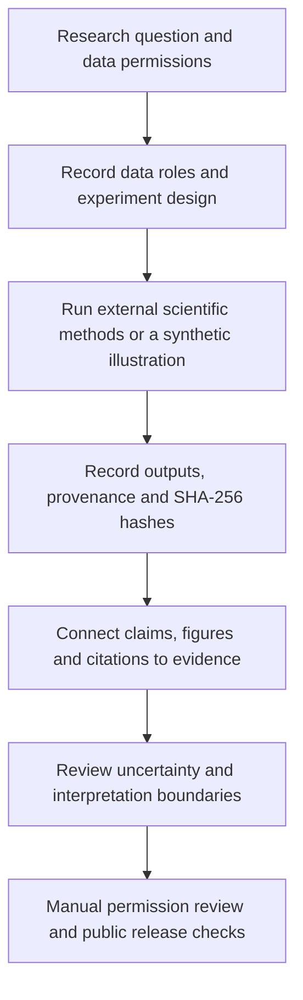

# Geophysical Research Workflow

**A reusable Agent Skill for traceable geophysical research, controlled experiments, and evidence-led scientific writing.**

[](https://github.com/PalmCivet-yyp/geophysical-research-workflow/actions/workflows/ci.yml)  [](LICENSE)

**English** · [简体中文](README.zh-CN.md) · [Skill definition](SKILL.md) · [Synthetic example](examples/README.md) · [Release history](CHANGELOG.md)

> **In one sentence:** Keep scientific questions, observations, priors, experiments, result files, figures, and paper claims connected—with explicit provenance and limitations.
>
> **Important:** This is an **AI-agent workflow and structural validation toolkit**, **not** a gravity inversion engine, seismic tomography solver, automatic literature fact-checker, or proof of scientific validity.

## 1. Why this project exists

A geophysical study rarely consists of one script. It may involve observations, Moho geometry, density priors, competing models, regularization choices, synthetic recovery tests, figures, and manuscripts. If these components are mixed or poorly documented, a numerically plausible result can be mistaken for a uniquely resolved geological interpretation.

This project turns a practical research discipline into a reusable Agent Skill: **define the question → register controlled comparisons → save traceable results → evaluate uncertainty → write appropriately bounded claims**. It is especially useful when combining gravity/seismic information or revising a paper under detailed methodological review.



## 2. What it can do

| Mode | Workflow support | Deliberate boundary |
| --- | --- | --- |
| **Research** | Record observation / geometry / prior roles; design controlled comparisons, synthetic recovery and sensitivity tests | Does **not** run a physical inversion or determine geological truth |
| **Publication** | Link claims to experiments, result files, figures and references; prepare cautious manuscript and reviewer-response checks | Does **not** fabricate numerical results or verify unread literature |
| **Release** | Check required files, possible secrets, large/binary files and publication-safe structure | A static scan **cannot** certify ownership, privacy or Git history |
| **Migration** | Extract reusable workflow rules from older project settings | Archived parameter choices are **not** universal defaults |

### What makes the workflow distinctive?

- **Clear data roles:** an independent observation is different from model geometry, a prior constraint, an external comparison, or a post-hoc diagnostic.
- **Experiments before conclusions:** write hypotheses, controls, dates and decision criteria; do not retrofit a threshold to match results.
- **Traceable evidence:** a `validated` *ledger status* needs linked files and SHA-256 entries, but still does **not** certify scientific validity.
- **Conservative interpretation:** fit quality, recovery of a prescribed structure, and physical identifiability are separate questions.
- **Privacy-conscious examples:** the public demonstration uses synthetic 1D signals with an abstract coordinate, not unpublished geophysical observations.

## 3. Quick start (offline, approximately 5 minutes)

**Requirements:** Python **3.10 or newer**. The bundled scripts use the Python standard library only; Git is needed only if you choose to clone the repository.

```bash
# 1. Download the repository and enter its root directory.
git clone https://github.com/PalmCivet-yyp/geophysical-research-workflow.git
cd geophysical-research-workflow

# 2. Generate an entirely synthetic 1D illustration (NOT physical modeling).
python scripts/demo_resolution.py --output ../toy-output

# 3. Generate a complete synthetic research ledger, including result hashes.
python scripts/build_toy_project.py ../toy-audited-project

# 4. Validate its metadata/evidence structure.
python scripts/workflow.py validate ../toy-audited-project
```

Expected final result:

```text
VALIDATION: STRUCTURE_OK_SCIENCE_UNVERIFIED (errors=0, warnings=...)
```

The number of warnings depends on the ledger content. **A successful check means the metadata structure is consistent—not that a real geophysical hypothesis has been demonstrated.** Example-generated files are written *outside* the repository by design.

### Start a real research ledger

```bash
# Do not create real research folders inside the public Skill checkout.
python scripts/workflow.py init ../my-geophysics-study

# Edit project.json; document data sources, units and roles; register experiments.
python scripts/workflow.py validate ../my-geophysics-study

# Obtain a result-file hash for file_manifest.csv:
python scripts/workflow.py hash ../my-geophysics-study/results/your-result.csv
```

A newly initialized and unfilled project is expected to **fail** validation. This is intentional: an empty form is not evidence.

**Windows:** use the same `python ...` commands in PowerShell (or `py -3 ...` if Python is registered under the Windows launcher). Run them from the repository root.

## 4. Install as an Agent Skill

Keep the **entire repository folder**, including `SKILL.md`, `scripts/`, `references/`, and `assets/`, together. Copy it to a Skill directory your agent client supports. For an environment that recognizes project-local `.agents/skills/`, a possible layout is:

```text
my-agent-project/
└── .agents/
    └── skills/
        └── geophysical-research-workflow/
            ├── SKILL.md
            ├── scripts/
            ├── references/
            └── assets/
```

Skill discovery and supported installation paths vary by client; consult its documentation and verify activation in your own environment. **Successful Python tests do not by themselves prove agent-side installation.**

Example agent request:

> Use `geophysical-research-workflow` to separate observations, Moho geometry, and prior constraints in my study. Suggest controlled recovery tests; then show which manuscript claims have traceable evidence and which remain unverified.

## 5. Project records and commands

| File | Purpose |
| --- | --- |
| `project.json` | Research question, spatial context, units, datasets and their roles |
| `experiment_registry.csv` | Experiment IDs, controlled factors, decision rules, dates, status and output paths |
| `evidence_ledger.csv` | Claim → experiment → result locator, uncertainty, limitations and permitted wording |
| `figure_manifest.csv` | Figure file, source data, processing code, coordinate system and display transformations |
| `citation_audit.csv` | Bibliographic metadata and whether a reference directly supports a specified claim |
| `file_manifest.csv` | Relative result path, SHA-256, provenance and licensing notes |

The structural validator checks required fields, cross-references, timestamp formats, restricted paths, output-file existence and registered SHA-256 digests. It does **not** evaluate forward equations, physical realism, uncertainty calibration, or published-paper accuracy.

```bash
# Validate a project and receive an explicit non-scientific status.
python scripts/workflow.py validate ../my-geophysics-study

# Run local repository checks before updating GitHub.
python scripts/validate_skill.py .
python scripts/check_release.py .
python -m unittest discover -s tests -v
```

Read [research-method.md](references/research-method.md), [publication-method.md](references/publication-method.md), [schemas-and-validation.md](references/schemas-and-validation.md), and the [Chinese code walkthrough](docs/code-tour.zh-CN.md) for detailed protocols, ledger fields, and commented source-code entry points.

## 6. Repository structure

```text
geophysical-research-workflow/
├── SKILL.md                  # Skill entry point and behavior requirements
├── README.md / README.zh-CN.md
├── scripts/                  # CLI tools, checks and synthetic generator
├── tests/                    # Automated regression tests
├── references/               # Domain-specific research and publication protocols
├── assets/                   # Empty JSON/CSV templates
├── examples/                 # Synthetic-only walkthrough and example files
├── docs/publishing.md        # Public-release checklist
├── .github/workflows/ci.yml  # CI for Linux/Windows and Python 3.10/3.12
├── CHANGELOG.md
├── CONTRIBUTING.md
├── SECURITY.md
└── LICENSE
```

The Python source includes **detailed Simplified Chinese comments** describing inputs, processing steps, evidence rules, failure cases, and scientific limitations. Comments do not change the computation logic.

## 7. Verification, scientific limits and privacy

**Software checks:** tests run across Python 3.10 and 3.12 on Ubuntu and Windows using [GitHub Actions](https://github.com/PalmCivet-yyp/geophysical-research-workflow/actions). Inspect the live workflow status rather than assuming a historical pass applies to future commits.

**Scientific distinction:** `STRUCTURE_OK_SCIENCE_UNVERIFIED` is deliberately not called `SCIENCE_VALIDATED`. A hash proves file integrity relative to the recorded digest; it does not prove that the data, inversion, claims or cited literature are scientifically correct. Likewise, a date written to a CSV is not independent proof of genuine preregistration.

**Responsible release:** the current open-source package contains tools and synthetic examples, **not** the private raw data, unpublished figures, manuscripts or reviewer correspondence of the study that inspired it. Do not upload third-party maps, observations, collaborator material or confidential files without authorization. The release scanner is heuristic and cannot audit your past Git commits.

See [publishing guidance](docs/publishing.md), [security policy](SECURITY.md), and [contribution guide](CONTRIBUTING.md).

## 8. License and citation

Licensed under the [MIT License](LICENSE) for the repository's original materials. This license does **not** convey rights to unrelated third-party geophysical data, software or publications.

For scholarly use, cite the actual scientific methods and datasets separately. For reuse of this workflow, link to this repository and identify the version or commit you used. No peer-reviewed scientific validation is implied by this repository.
