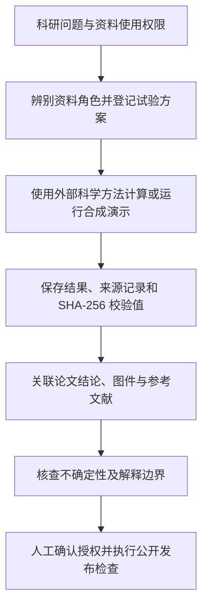

# 地球物理科研工作流 · Geophysical Research Workflow

**面向地球物理研究、受控检验与学术论文证据核查的可复用 Agent Skill。**

[](https://github.com/PalmCivet-yyp/geophysical-research-workflow/actions/workflows/ci.yml)  [](LICENSE)

**简体中文** · [English](README.md) · [Skill 核心指令](SKILL.md) · [合成演示](examples/README.md) · [版本记录](CHANGELOG.md)

> **一句话介绍：** 把科研问题、原始观测、模型先验、受控试验、结果文件、图件和论文结论组织为可追溯的证据链，并明确每项结论的限制。
>
> **能力边界：** 这是一套**AI科研工作流与结构化验证工具**，不是重力反演程序、地震层析求解器、自动文献真伪核验工具，也不能单独证明科学结论成立。

## 1. 为什么开发这个项目？

完整的地球物理研究往往不止一段计算代码，还包括观测资料、Moho 几何条件、密度先验、不同模型设置、正则化方案、合成恢复试验、科研图件和论文写作。如果这些材料之间的角色和关系不明确，可能把**数值拟合较好**误认为**地质结构可以被唯一识别**，也会增加复现、审稿和论文修改的成本。

本项目把实际科研中的方法约束转化为可重复执行的 Agent Skill：**明确问题 → 登记受控比较 → 保存可追溯结果 → 评价不确定性 → 形成有证据边界的结论**。特别适合多源重力—地震研究、科研数据审核和方法型论文修订。



## 2. 核心功能

| 工作模式 | 可以辅助完成 | 不承担的工作 |
| --- | --- | --- |
| **科研执行 Research** | 辨别观测、几何与先验条件；整理受控比较、恢复试验与敏感性检验 | 不能自行完成物理反演或确定真实地质结构 |
| **论文组织 Publication** | 建立结论—试验—结果—图件—引文之间的证据联系 | 不能编造数值、代替阅读文献或保证论证正确 |
| **公开审计 Release** | 检查文件结构、疑似敏感信息、二进制资料和潜在发布风险 | 静态检查不能替代版权审核、隐私检查和 Git 历史审计 |
| **项目迁移 Migration** | 从旧科研项目中提炼可复用规则、隔离历史假设 | 不会把旧版本的参数或论文状态视为普适结论 |

### 设计重点

- **资料角色清晰：** 区分独立观测、模型几何、先验约束、外部对比模型以及后验解释，避免混淆证据来源。
- **先确定检验条件，再判断结果：** 登记假设、控制因素、时间及判定标准，避免根据输出事后调整比较口径。
- **结果可追溯：** 台账中的 `validated` 需要关联实际文件和 SHA-256 校验记录；但这只是**工作流状态**，不是科学结论认证。
- **解释保持审慎：** 区分拟合效果、已知结构的恢复能力与真实地质结构的可识别性。
- **公开案例独立于真实科研数据：** 示例为抽象坐标下的合成一维信号，不包含未发表的观测资料或真实地质解释。

## 3. 五分钟快速体验（离线运行）

**环境要求：** Python **3.10及以上**。附带的 Python 脚本只使用标准库；仅在选择克隆仓库时需要 Git。

在终端按顺序执行：

```bash
# 1. 下载仓库，进入项目根目录。
git clone https://github.com/PalmCivet-yyp/geophysical-research-workflow.git
cd geophysical-research-workflow

# 2. 生成完全合成的一维演示（不是地球物理正演/反演）。
python scripts/demo_resolution.py --output ../toy-output

# 3. 自动生成完整的示例科研台账，包括结果文件与哈希记录。
python scripts/build_toy_project.py ../toy-audited-project

# 4. 检查示例的文件与证据组织是否一致。
python scripts/workflow.py validate ../toy-audited-project
```

正常情况下，最后会显示类似结果：

```text
VALIDATION: STRUCTURE_OK_SCIENCE_UNVERIFIED (errors=0, warnings=...)
```

`warnings` 数量取决于台账中的记录。**检查通过只说明结构和登记关系符合规则，绝不等于地球物理假设已经得到证明。** 示例输出默认放在仓库外部，以防止误上传数据文件。

### 为自己的研究创建台账

```bash
# 真实科研项目不要存放在公开Skill源码目录里。
python scripts/workflow.py init ../my-geophysics-study

# 按实际情况填写 project.json、数据来源、角色和试验登记，再执行检查。
python scripts/workflow.py validate ../my-geophysics-study

# 生成结果文件的哈希值，填写到 file_manifest.csv 中。
python scripts/workflow.py hash ../my-geophysics-study/results/your-result.csv
```

**新初始化但尚未填写的项目会验证失败，这是预期的防错行为。** 空白科研台账不能被认定为已完成研究。

Windows 用户可在 PowerShell 中运行相同的 `python` 命令；如果使用 Python 启动器，也可将命令中的 `python` 换成 `py -3`。请始终在仓库根目录执行命令。

## 4. 安装为 Agent Skill

把完整的 `geophysical-research-workflow` 文件夹放到所用AI助手支持的 Skills 位置，**不要只单独复制 `SKILL.md`**。例如，在支持项目级 `.agents/skills/` 目录的客户端中，可使用：

```text
my-agent-project/
└── .agents/
    └── skills/
        └── geophysical-research-workflow/
            ├── SKILL.md
            ├── scripts/
            ├── references/
            └── assets/
```

不同 Agent 客户端对 Skill 安装路径和调用方式的要求可能不同，应以所用客户端文档为准，并在真实环境中进行调用测试。**Python 测试通过不等于 Agent 端已经成功安装。**

可向AI助手提出这样的任务：

> 使用 `geophysical-research-workflow` 检查我的科研项目：区分独立观测、Moho几何条件和模型先验；制定不同参数下的合成恢复试验；核对论文定量结论是否有可靠的结果来源，并明确目前无法验证的部分。

## 5. 科研台账与命令说明

| 文件 | 用途 |
| --- | --- |
| `project.json` | 科研问题、空间范围、坐标/深度约定、单位、资料来源与资料角色 |
| `experiment_registry.csv` | 试验编号、受控因素、判定标准、登记/执行时间、状态及输出文件 |
| `evidence_ledger.csv` | 论文结论对应的试验、结果位置、不确定性、局限与允许使用的表达 |
| `figure_manifest.csv` | 图件文件、原始数据、绘图代码、坐标系统及显示变换 |
| `citation_audit.csv` | 引文基本信息以及是否直接支持特定研究结论 |
| `file_manifest.csv` | 结果文件的相对路径、SHA-256校验值、来源及版权说明 |

`validate` 主要检查必填字段、表格间关联、UTC时间格式、危险路径、文件是否存在以及结果文件的SHA-256一致性；**不会**判断正演方程是否正确、反演是否收敛、误差模型是否合理或文献结论是否真实。

```bash
# 核查研究台账。
python scripts/workflow.py validate ../my-geophysics-study

# 公开仓库的本地检查。
python scripts/validate_skill.py .
python scripts/check_release.py .
python -m unittest discover -s tests -v
```

想了解更详细的使用规则，可阅读：[科研方法](references/research-method.md)、[论文与证据审计](references/publication-method.md)、[数据格式及校验](references/schemas-and-validation.md)。

## 6. 仓库结构

```text
geophysical-research-workflow/
├── SKILL.md                  # Agent Skill 的主入口与任务约束
├── README.md / README.zh-CN.md
├── scripts/                  # 项目初始化、验证、文件校验和合成演示
├── tests/                    # 自动化回归测试
├── references/               # 科研方法、论文组织及发布安全规范
├── assets/                   # 空白 JSON/CSV 科研台账模板
├── examples/                 # 合成案例操作说明和示例结果
├── docs/publishing.md        # GitHub 公开发布核查清单
├── .github/workflows/ci.yml  # Linux/Windows + Python 3.10/3.12 自动检查
├── CHANGELOG.md
├── CONTRIBUTING.md
├── SECURITY.md
└── LICENSE
```

主要 Python 源码已经补充**详细的简体中文注释和函数说明**，重点解释输入输出、处理流程、结果追踪方式、错误处理和科学解释边界，而不是对每一行代码进行重复翻译。

## 7. 测试、科研可信度与隐私

**软件测试：** 仓库使用 [GitHub Actions](https://github.com/PalmCivet-yyp/geophysical-research-workflow/actions) 在Ubuntu、Windows及Python 3.10、3.12环境运行。每次修改后应查看实际运行结果，不应将过去的通过记录自动视为新版本通过。

**科学边界：** `STRUCTURE_OK_SCIENCE_UNVERIFIED` 意味着“结构检查通过，但科学结论未经本工具验证”。SHA-256只能确认文件与登记哈希一致，不能证明数据来源或结论正确；CSV中的登记时间也不能单独作为真正事前注册的证明。

**隐私及版权：** 公开包保留的是通用方法、工具和合成案例，没有放入启发该工作的历史科研项目原始数据、未发表成果图、论文或审稿通信。实际使用中仍需自行确认第三方资料、合作者成果和研究机构的公开权限。发布脚本只做启发式检查，不能审计过去的Git提交历史。

请同时阅读[发布指南](docs/publishing.md)、[安全政策](SECURITY.md)和[贡献指南](CONTRIBUTING.md)。

## 8. 许可与引用

本仓库自主编写的代码和文档使用 [MIT许可证](LICENSE)，不意味着第三方科研数据、论文、地图或合作代码自动获得同样许可。

学术使用中仍应单独引用真实采用的科学方法、数据和文献；引用本项目的工作流设计时，可提供仓库链接以及所使用版本或提交编号。GitHub开源发布并不意味着通过学术同行评审。
